<div align="center">

<a href="https://jatin-pandey-portfolio.vercel.app/"></a>

<a href="https://jatin-pandey-portfolio.vercel.app/"></a>

### Building things, breaking things, and occasionally fixing them.

<sub>My main account <a href="https://github.com/satiricalguru">@satiricalguru</a> is under review by GitHub. This is my backup account; every project is mirrored here.</sub>


<a href="https://jatin-pandey-portfolio.vercel.app/"></a>

<a href="https://github.com/JayDev-27?tab=followers"></a>
<a href="https://hits.sh/github.com/satiricalguru-profile/"></a>
<a href="https://www.linkedin.com/in/jatin-pandey-66328141a/"></a>
<a href="https://x.com/JayDevSG"></a>
<a href="https://leetcode.com/u/KiKISJ3blF/"></a>
<a href="mailto:jatinjio1212@gmail.com"></a>


</div>

<br>

```txt
> whoami
  Jatin Pandey · B.Tech CSE @ Manipal University Jaipur · Jaipur, IN
> cat focus.txt
  local-first AI tools · native desktop apps · real-time audio · reverse engineering
> echo $HOBBIES
  anime (Reze is the best) · GTA VI countdown · keeping the Duolingo streak alive
```

I build **local-first AI tools**, **native desktop apps** and **real-time audio software**, then take them apart to see where they **break**. Most of what I make runs on *your* machine, not someone else's cloud. Off the clock I play **CTFs** and read binaries in **Ghidra**.

<br>

## ▣ &nbsp;Selected work

<sub>Real screenshots. Every card opens the repo · more on the <a href="https://jatin-pandey-portfolio.vercel.app/#work">portfolio</a>.</sub>

<table>
<tr>
<td width="50%" valign="top">
<a href="https://project-beatrice.vercel.app"></a>
<b>Project Beatrice</b> &nbsp;<a href="https://project-beatrice.vercel.app"></a><br>
<sub>Real-time AI voice changer · 112 voices · ~10 ms · fully on-device</sub>
</td>
<td width="50%" valign="top">
<a href="https://github.com/JayDev-27/Synthid-remover"></a>
<b>SynthID Remover</b> &nbsp;<br>
<sub>Strips AI watermarks, C2PA credentials and SynthID signals, locally</sub>
</td>
</tr>
<tr>
<td width="50%" valign="top">
<a href="https://brawlverse.vercel.app"></a>
<b>Brawlverse</b> &nbsp;<br>
<sub>3D web brawler · Three.js, Blender MCP and Tripo 3D assets</sub>
</td>
<td width="50%" valign="top">
<a href="https://github.com/JayDev-27/Hikari"></a>
<b>Hikari</b> &nbsp;<br>
<sub>Local-first anime AI companion for macOS with Live2D/VRM and phoneme lip-sync</sub>
</td>
</tr>
<tr>
<td width="50%" valign="top">
<a href="https://github.com/JayDev-27/Vantage"></a>
<b>Vantage</b> &nbsp;<br>
<sub>Fast, free live wallpapers for macOS, beneath your desktop icons</sub>
</td>
<td width="50%" valign="top">
<a href="https://github.com/JayDev-27/ledgerlite"></a>
<b>LedgerLite</b> &nbsp;<br>
<sub>Local-first personal finance manager · React 18, TypeScript &amp; Three.js</sub>
</td>
</tr>
</table>

<details>
<summary>▸ <b>More builds</b> — MangaDock · FloodSetu · Frontend Library · RVC · Jarvis · OpenBot · Aurora…</summary>
<br>

| Project | What it is |
|:--|:--|
| [**Jarvis**](https://github.com/JayDev-27/Jarvis) | Holographic voice assistant with voice cloning &amp; real macOS actions |
| [**OpenBot**](https://github.com/JayDev-27/OpenBot) | Open-source AI teammates, each with its own sandboxed computer |
| [**MangaDock**](https://mangadock.vercel.app) | Free, ad-free, open-source reader for manga, manhwa &amp; manhua |
| [**FloodSetu**](https://floodsetu.vercel.app) | Multi-agent flood rescue dispatch with offline SOS and a tamper-evident ledger |
| [**Frontend Library**](https://github.com/JayDev-27/Frontend-Library) | 14,500+ curated frontend assets with live previews |
| [**RVC Voice Changer**](https://github.com/JayDev-27/RVC-Voicechanger) | Retrieval-based voice conversion with a Pedalboard DSP chain |
| [**Aurora**](https://github.com/JayDev-27/Aurora-Voice) · [**Opencode-bridge**](https://github.com/JayDev-27/Opencode-bridge) | Ultra-low-latency macOS voice changer · free models inside Claude Desktop |

</details>

<br>

### Canary

Canary is an early-warning prototype for workforce and population health. Upload daily aggregate counts to see why a site was flagged, compare missing-feed scenarios, and record a human review.

[Source code](https://github.com/JayDev-27/Canary) · [Live demo](https://canary-jatinjio1212-8258s-projects.vercel.app/analyze) · [Reviewer walkthrough](https://github.com/JayDev-27/Canary/blob/main/docs/deployment.md#reviewer-walkthrough)

<details>
<summary>See the site analysis screen</summary>
<br>

</details>


## ▦ &nbsp;Top public projects

<sub>Top non-forked public repositories by stars, synced hourly.</sub>

<!-- projects:start -->

<div align="center">
<a href="https://github.com/JayDev-27/Frontend-Library"></a>
<a href="https://github.com/JayDev-27/Vantage"></a>
<a href="https://github.com/JayDev-27/Airshift"></a>
<a href="https://github.com/JayDev-27/Brawlverse"></a>
<a href="https://github.com/JayDev-27/Canary"></a>
<a href="https://github.com/JayDev-27/Hikari"></a>
<a href="https://github.com/JayDev-27/innodata-task-factory"></a>
<a href="https://github.com/JayDev-27/ledgerlite"></a>
</div>

<!-- projects:end -->

## ⇄ &nbsp;Merged upstream

<sub>Pull requests merged into well-known open-source projects.</sub>

<table>
<tr>
<td align="center" width="25%"><a href="https://github.com/NousResearch/hermes-agent/pull/150667"></a><br><b>hermes-agent</b><br><sub>NousResearch · 263k★</sub><br><sub>Dropstation folder inboxes</sub></td>
<td align="center" width="25%"><a href="https://github.com/astral-sh/ty/pull/4978"></a><br><b>ty</b><br><sub>astral-sh · 20k★</sub><br><sub>PyCharm 2026.3 setup docs</sub></td>
<td align="center" width="25%"><a href="https://github.com/corsairdev/corsair/pull/1386"></a><br><b>corsair</b><br><sub>corsairdev · 15.7k★</sub><br><sub>Parseur integration, 29 ops</sub></td>
<td align="center" width="25%"><a href="https://github.com/apache/libcloud/pull/2221"></a><br><b>libcloud</b><br><sub>apache · 2.1k★</sub><br><sub>Bracketed IPv6 endpoint parsing</sub></td>
</tr>
</table>

<br>

## ⚙ &nbsp;Toolkit

<div align="center">

<a href="https://skillicons.dev"></a>
<br>
<a href="https://skillicons.dev"></a>

<br><br>

<sub><b>⚡ THE AGENTS I WORK WITH</b> — ranked by how often they're in my terminal</sub>
<br><br>

<table>
<tr>
<td align="center" width="25%"><a href="https://claude.com/claude-code"></a><br><b>01 · Claude</b><br><sub>Lead engineer</sub></td>
<td align="center" width="25%"><a href="https://openai.com/codex"></a><br><b>02 · Codex</b><br><sub>Coding agent</sub></td>
<td align="center" width="25%"><a href="https://antigravity.google"></a><br><b>03 · Antigravity</b><br><sub>Agentic IDE</sub></td>
<td align="center" width="25%"><a href="https://opencode.ai"></a><br><b>04 · OpenCode</b><br><sub>Terminal agent</sub></td>
</tr>
</table>

</div>

<br>

## ▤ &nbsp;Records

<div align="center">

<a href="https://github.com/JayDev-27"></a>
<a href="https://github.com/JayDev-27"></a>

<a href="https://github.com/JayDev-27"></a>

<details>
<summary>🏆 <b>Achievements unlocked</b></summary>
<br>

<table border="0">
<tr>
<td align="center" width="20%"><br><sub>YOLO</sub></td>
<td align="center" width="20%"><br><sub>Pull Shark ×2</sub></td>
<td align="center" width="20%"><br><sub>Pair Extraordinaire</sub></td>
<td align="center" width="20%"><br><sub>Quickdraw</sub></td>
<td align="center" width="20%"><br><sub>Public Sponsor</sub></td>
</tr>
</table>

</details>

<br>

<picture>
  <source media="(prefers-color-scheme: dark)" srcset="https://raw.githubusercontent.com/JayDev-27/JayDev-27/output/github-contribution-grid-snake-dark.svg">
  <source media="(prefers-color-scheme: light)" srcset="https://raw.githubusercontent.com/JayDev-27/JayDev-27/output/github-contribution-grid-snake.svg">
  
</picture>

</div>

<br>

## ♥ &nbsp;Sponsors

<div align="center">

<a href="https://github.com/sponsors/satiricalguru"></a>

<sub>Live: this updates the moment someone sponsors. Every sponsor becomes a pixel portrait in the <a href="https://jatin-pandey-portfolio.vercel.app/#sponsors">hall of fame</a>.</sub>

<br><br>

<a href="https://github.com/sponsors/satiricalguru"></a>

</div>

<br>

## ✉ &nbsp;Say hello

<div align="center">

**Internships, collaborations, a CTF team that needs a reverser, or an idea that should run locally.**

<a href="mailto:jatinjio1212@gmail.com"></a>
<a href="https://jatin-pandey-portfolio.vercel.app/#contact"></a>

<br><br>

<sub>Banner drawn in code (<a href="scripts/pixel_banner.py">scripts/pixel_banner.py</a>) · there's a pixel cat on the <a href="https://jatin-pandey-portfolio.vercel.app/">portfolio</a> · 1000 − 7 = 993</sub>

</div>
