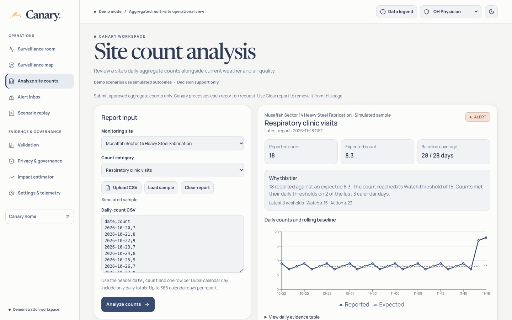

  
  
<strong>I build web apps, experiment with local-first AI, and make interactive 3D experiences.</strong>

  

    <a href="https://jatin-pandey-portfolio.vercel.app/">Portfolio</a> ·
    <a href="https://www.linkedin.com/in/jatin-pandey-dev">LinkedIn</a> ·
    <a href="https://x.com/JayDevSG">X</a> ·
    <a href="mailto:jatinjio1212@gmail.com">Email</a>
  

## Featured project

### Canary

An early-warning prototype for workforce and population health, built for the Future Health Digital Innovation Challenge. Canary compares daily aggregate counts with a rolling baseline, shows why an alert was raised, and puts the decision in a human reviewer’s hands. It adds live weather and air-quality context and withholds small counts before scoring.

[Source code](https://github.com/JayDev-27/Canary) · [Try the sample](https://canary-jatinjio1212-8258s-projects.vercel.app/analyze) · [Reviewer walkthrough](https://github.com/JayDev-27/Canary/blob/main/docs/deployment.md#reviewer-walkthrough)

## More projects

- **Three.js Library** brings together procedural worlds and scroll-driven WebGL scenes, including a sunset meadow, an underwater reef, and a Jaipur-inspired cityscape. [Source code](https://github.com/JayDev-27/threejs-library) · [Live gallery](https://threejs-scroll-showcases.vercel.app/)
- **Open Source Lab** is a repository for collaborative open-source experiments. [Source code](https://github.com/JayDev-27/open-source-lab)

## What I’m exploring

I’m interested in software that can run on the device, especially local AI, native macOS apps, and real-time audio. On the web, I work with TypeScript, Next.js, and Three.js. For APIs and data pipelines, I use Python and FastAPI.
